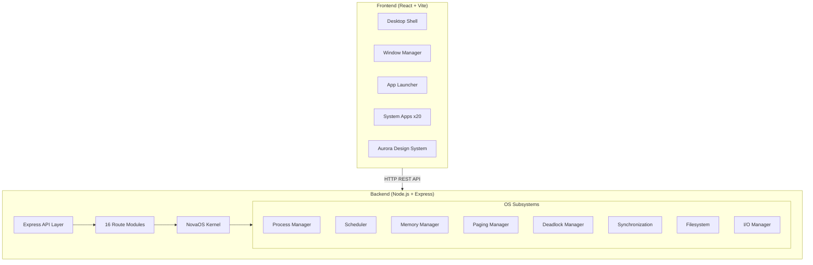
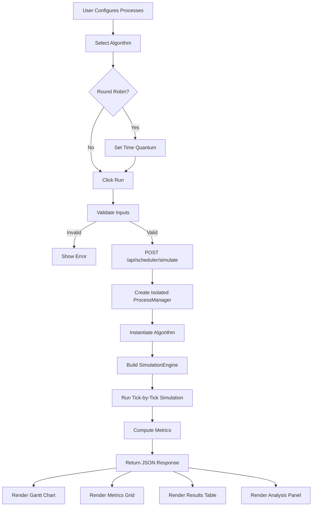
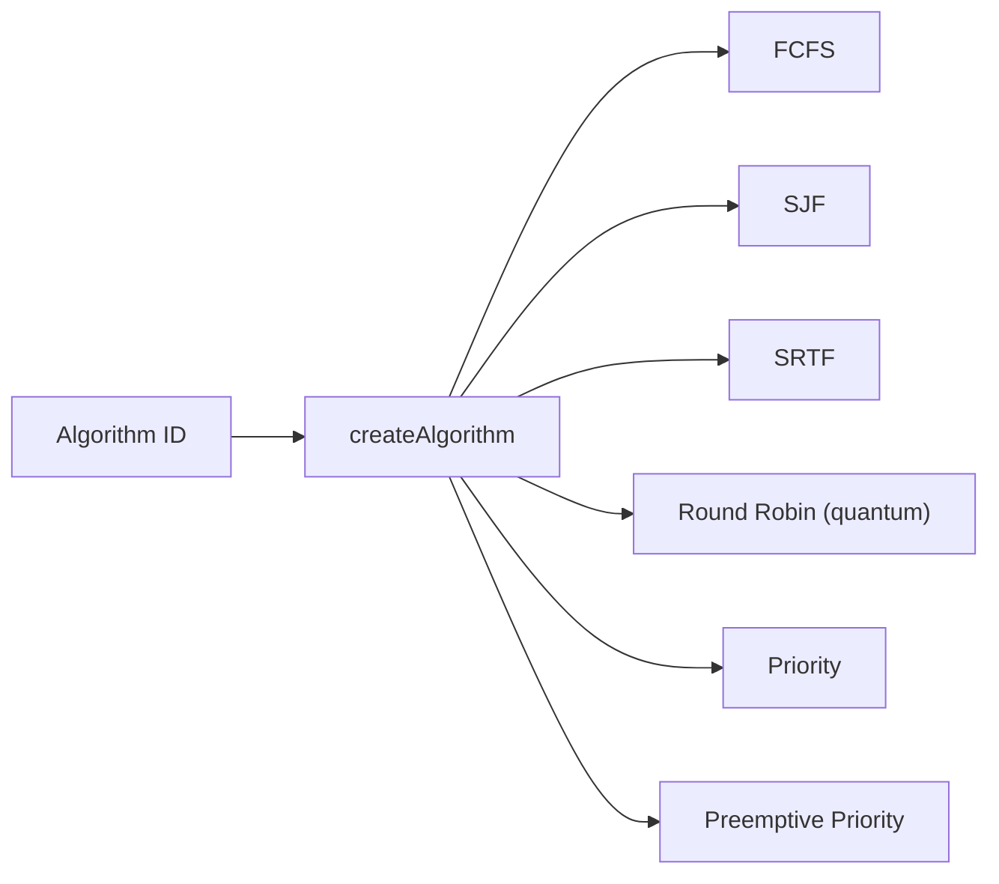
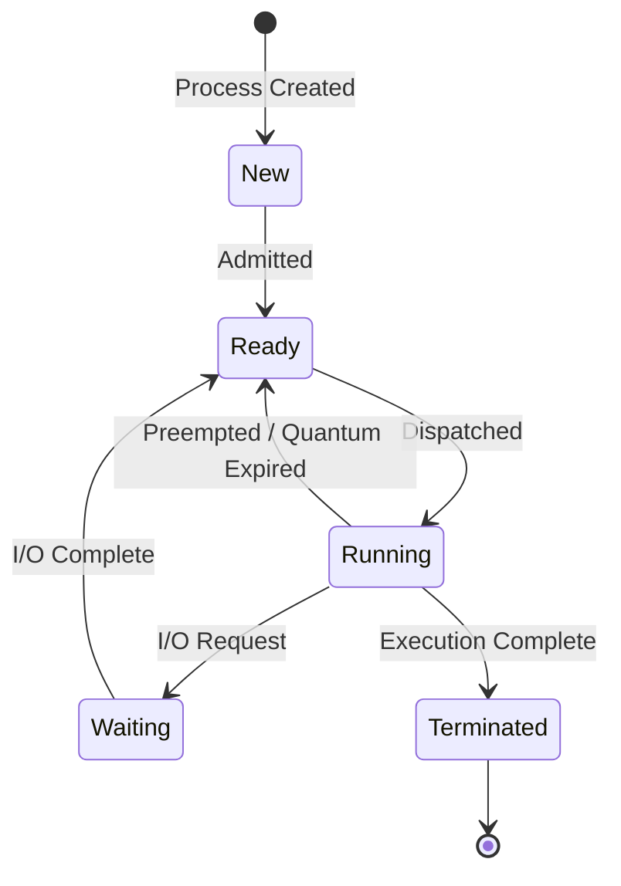
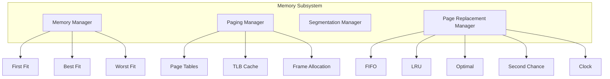
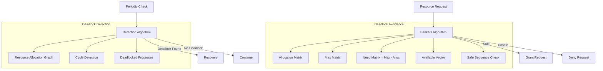
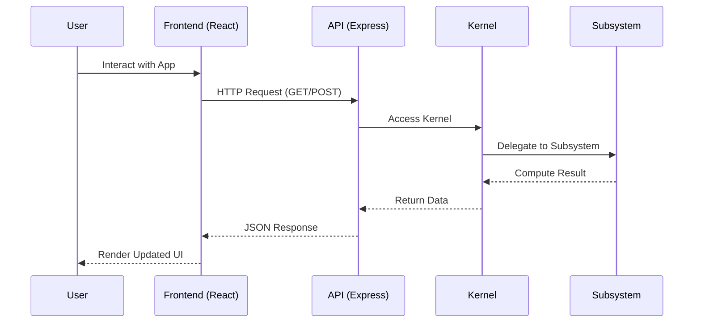
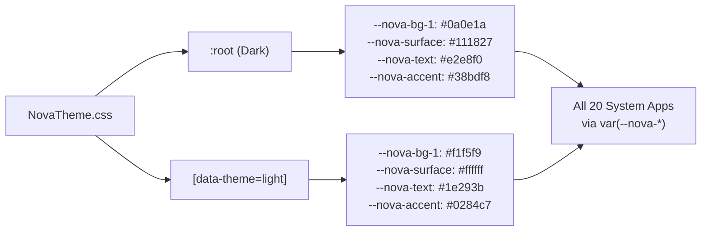

# NovaOS Architecture Diagrams

## 1. System Architecture

## 2. CPU Scheduler Flow

## 3. Scheduling Algorithm Selection

## 4. Process State Diagram

## 5. Memory Management Hierarchy

## 6. Deadlock Management

## 7. Client-Server Data Flow

## 8. Theme System

